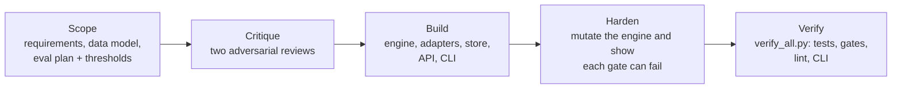

# bulk_proj_mono

Twelve independent, local-first Python products in one [uv](https://docs.astral.sh/uv/)
workspace.

Each product went through the same gated process. Before any code was written it was
specified (numbered requirements, a data model, and an eval plan with explicit pass/fail
thresholds) and then attacked by two adversarial reviews. Only after that was it built,
engine first, and it counts as done only when its eval gates pass. The gates are
ordinary `pytest` tests, so a regression fails the build.



- Process, per-project test and gate counts, and known limits:
  [projects/README.md](projects/README.md)
- Engineering rules every project follows: [projects/CONVENTIONS.md](projects/CONVENTIONS.md)
- Each project's `docs/` folder holds its `SCOPE`, `DATA_MODEL`, `EVALS` and `REVIEW`
  (every review finding and how it was resolved).

## The twelve

| Project | What it does |
|---------|--------------|
| [formcoach](projects/formcoach/) | Builds training programs from published volume and RIR guidelines, and flags squat form faults from pose keypoints |
| [flowlist](projects/flowlist/) | Reorders a playlist so consecutive tracks mix cleanly (Camelot key, BPM, energy, loudness) |
| [chessmentor](projects/chessmentor/) | Chess opponent with its own throttleable engine that estimates your strength and explains your mistakes |
| [datasweep](projects/datasweep/) | Watches folders and cleans CSV/TSV/XLSX/JSONL files without touching the originals, with a reversible audit log |
| [ethos](projects/ethos/) | Answers a moral question from ten traditions side by side, with every quotation verified against a committed corpus |
| [voicekin](projects/voicekin/) | Consent-gated voice profiles: the house speaks in someone's voice only after a speaker-matched consent check |
| [tickerpress](projects/tickerpress/) | Watches RSS/Atom feeds for watchlist companies, merges syndicated copies of a story and delivers ranked digests and alerts |
| [newsalpha](projects/newsalpha/) | Extracts typed events from financial news, scores them as signals and checks them with a leak-free event-study backtest |
| [pointsmax](projects/pointsmax/) | Finds the highest-value credit-card points redemption via graph search, checked against a brute-force oracle |
| [grailtrader](projects/grailtrader/) | Builds price indices for secondhand designer clothing and gives buy/sell/hold guidance with a backtest |
| [dresscast](projects/dresscast/) | Assembles layered outfits from your tagged wardrobe based on the day's hourly weather |
| [almanac](projects/almanac/) | Quote and idea bank that resurfaces one card a day, balancing new entries against long-unseen ones, with an application prompt |

## Quick start

```bash
cd projects
uv sync --all-packages          # install all twelve
uv run ethos ask "what do I owe my aging parents?"
uv run python verify_all.py     # run every test, gate, linter and CLI
```

Each project is a Typer CLI with an optional FastAPI server. There are no accounts and no
API keys, and nothing touches the network on the default path. External services sit
behind adapters with deterministic offline defaults, and each project keeps its own
SQLite database under your home directory.

The voicekin eval corpus (about 490 synthetic WAVs) is not committed. It is generated
from a seeded script on first run and checked against `corpus_manifest.json`.

## Verification

`verify_all.py` runs every project's tests, eval scorecard, linter and CLI, and exits
non-zero on any failure. Across the twelve projects there are 4,518 tests that run by
default (pytest collects 4,521; three are opt-in or need an optional extra) and 242
gated metrics in the eval scorecards. Per-project counts are in
[projects/README.md](projects/README.md).

## Requirements

- Python 3.11+
- [uv](https://docs.astral.sh/uv/)

## License

[MIT](LICENSE)
